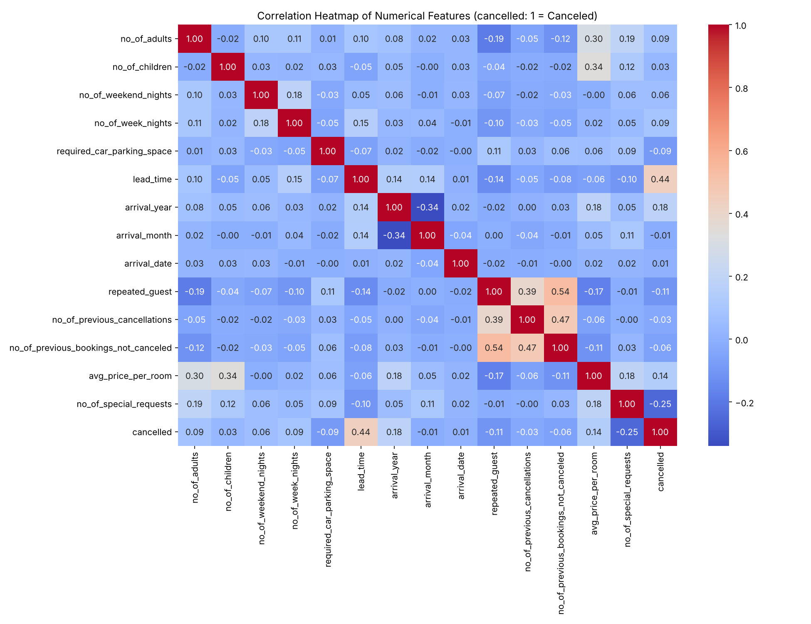
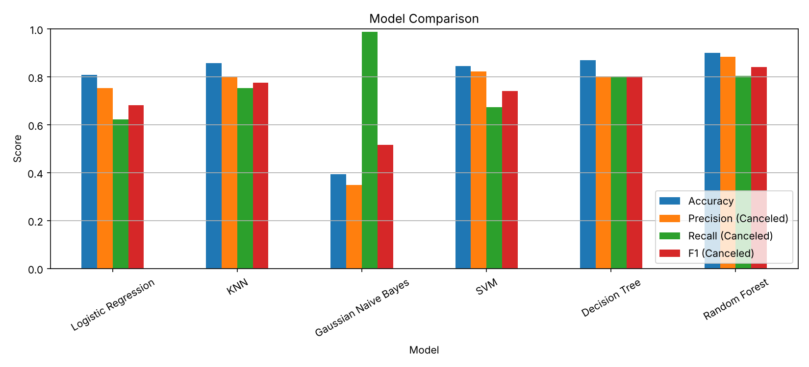
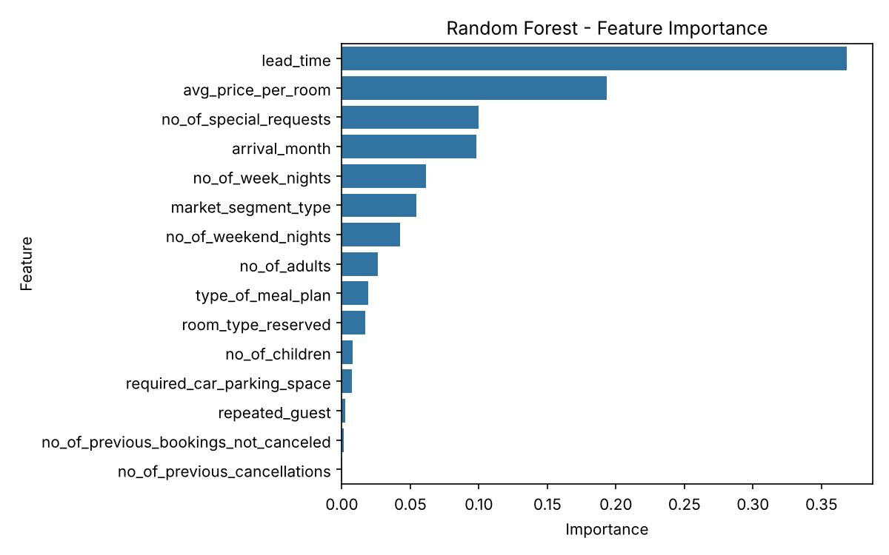
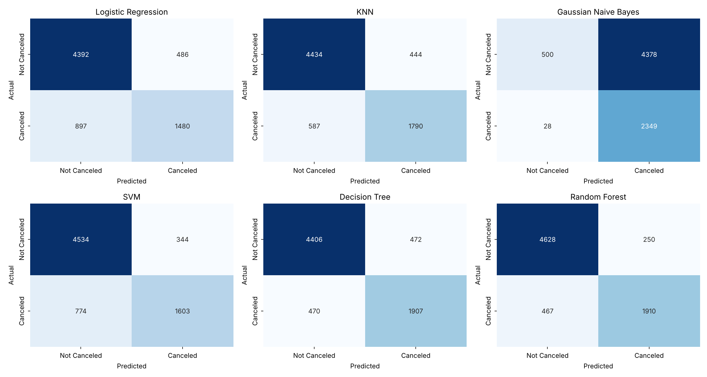

# Hotel Reservation Cancellation Prediction Using Machine Learning

[](https://www.python.org/)
[](https://jupyter.org/)
[](LICENSE)

A binary classification machine learning project that predicts whether a hotel reservation will be **cancelled** or **not cancelled** based on booking details available at reservation time. Compares six classification models and analyzes key cancellation drivers.

---

## 📌 Problem Statement
Can we accurately predict whether a hotel booking will be cancelled using customer, reservation, and pricing features known at booking time? Accurately forecasting cancellations allows hotel revenue managers to optimize overbooking strategies, adjust dynamic pricing, and implement proactive retention offers.

---

## 📊 Dataset Overview
- **Source**: [Hotel Reservations Classification Dataset](https://www.kaggle.com/datasets/ahsan81/hotel-reservations-classification-dataset) (Kaggle)
- **Observations**: 36,275 reservations
- **Features**: 19 columns (lead time, room type, market segment, special requests, average price per room, repeated guest status, etc.)
- **Target**: `booking_status`
  - `Not_Canceled`: 24,390 bookings (67.24%)
  - `Canceled`: 11,885 bookings (32.76%)

---

## ⚙️ Methodology & Pipeline
1. **Exploratory Data Analysis (EDA)**: Distribution of cancellations, market segments, lead time variations, room pricing, and correlation analysis.
2. **Data Preprocessing**:
   - Dropped non-predictive identifiers (`Booking_ID`, `arrival_year`, `arrival_date`).
   - Categorical feature encoding via `LabelEncoder`.
   - Stratified 80/20 train-test split (`random_state=42`) ensuring class balance.
   - Feature scaling using `StandardScaler` (fitted strictly on training data).
3. **Model Training & Comparison**:
   - Logistic Regression
   - K-Nearest Neighbors (KNN)
   - Gaussian Naive Bayes
   - Support Vector Machine (SVM with RBF kernel)
   - Decision Tree
   - Random Forest Classifier
4. **Evaluation**: Confusion matrices, accuracy, precision, recall, and F1-score for the minority/critical `Canceled` class.
5. **Interpretability & Sensitivity**:
   - Feature importance extraction from Random Forest.
   - Decision tree visualization.
   - Sensitivity check evaluating model degradation without `no_of_special_requests`.

---

## 🏆 Model Performance (Test Set: 7,255 Bookings)

| Model | Accuracy | Precision (Canceled) | Recall (Canceled) | F1-Score (Canceled) |
|---|:---:|:---:|:---:|:---:|
| Logistic Regression | 80.94% | 0.7528 | 0.6226 | 0.6816 |
| K-Nearest Neighbors (KNN) | 85.79% | 0.8013 | 0.7531 | 0.7764 |
| Gaussian Naive Bayes | 39.27% | 0.3492 | **0.9882** | 0.5160 |
| Support Vector Machine (SVM) | 84.59% | 0.8233 | 0.6744 | 0.7414 |
| Decision Tree | 87.02% | 0.8016 | 0.8023 | 0.8019 |
| **Random Forest** | **90.12%** | **0.8843** | **0.8035** | **0.8420** |

> **Key takeaway**: **Random Forest** delivered the best overall performance with **90.12% Accuracy** and **0.8420 F1-score** on cancellations. Gaussian Naive Bayes achieved near-perfect recall (98.8%) but severely over-predicted cancellations (~93% of all samples), resulting in very poor precision and accuracy.

---

## 📈 Visualizations & Insights

### Correlation Heatmap


### Model Comparison


### Feature Importance (Random Forest)


### Confusion Matrices


---

## 🔍 Key Findings
- **Lead Time**: By far the strongest predictor (Random Forest importance: ~0.37). Cancelled reservations averaged **139 days** lead time vs. **59 days** for completed stays.
- **Market Segment**: Online bookings experienced the highest cancellation rate (**36.51%**), whereas corporate bookings saw only **10.91%** cancellations, and complementary bookings had **0%**.
- **Special Requests**: Guests with 0 special requests had a **43.21%** cancellation rate, dropping sharply to **14.60%** for guests with 2 requests.
- **Repeated Guests**: Repeat visitors cancelled only **1.72%** of the time compared to **33.58%** for first-time visitors.

---

## 📁 Repository Structure
```
├── Hotel Reservations.csv                  # Dataset (36,275 records)
├── Untitled.ipynb                          # Interactive Jupyter Notebook with all outputs
├── Hotel_Cancellation_Report_Notebook.docx# Project report document
└── figures/                                # High-resolution generated charts & plots
```

---

## 🚀 Getting Started

### 1. Clone the repository
```bash
git clone https://github.com/Manjarink/Hotel-Cancellation-Prediction.git
cd Hotel-Cancellation-Prediction
```

### 2. Launch Jupyter Notebook
```bash
jupyter notebook Untitled.ipynb
```

---

## 👤 Author
**Manjari N.K.**
- GitHub: [@Manjarink](https://github.com/Manjarink)
